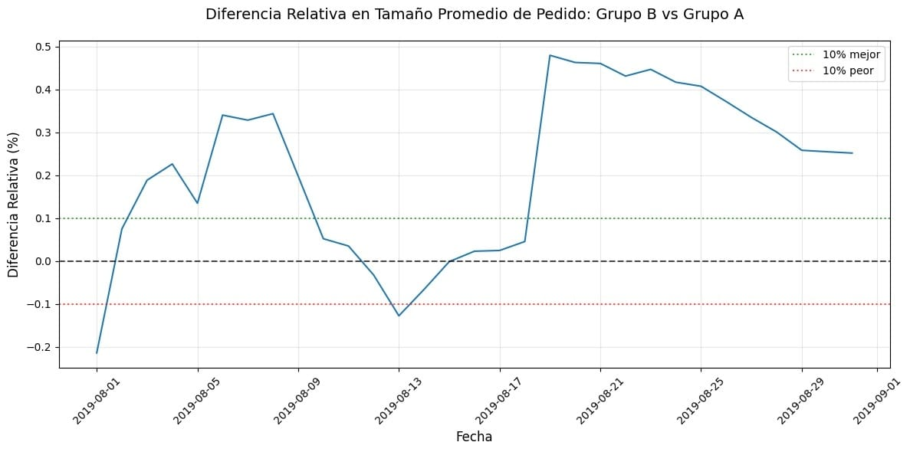

# analisis-priorizacion-de-hipotesis-y-ab-test
Análisis  para aumentar ingresos, priorizar hipótesis con frameworks ICE/RICE hasta validar con un A/B Test.

# 🧪 Priorización de Hipótesis y A/B Test - Tienda Online

[Python](https://img.shields.io/badge/Python-3776AB?style=for-the-badge&logo=python&logoColor=white)
[Pandas](https://img.shields.io/badge/Pandas-150458?style=for-the-badge&logo=pandas&logoColor=white)
[A/B Testing](https://img.shields.io/badge/A%2FB_Testing-FF6B6B?style=for-the-badge)
[Statistics](https://img.shields.io/badge/Statistics-4ECDC4?style=for-the-badge)

 
 
> Análisis completo para aumentar ingresos de un e-commerce: desde priorizar hipótesis con frameworks ICE/RICE hasta validar con un A/B Test.

## 📁Archivo:
-'priorizacion_hipotesis.ipynb' -notebook con el análisis completo.
### 🎯 Objetivo del Proyecto
El equipo de marketing propone 9 hipótesis para aumentar ingresos. Tu trabajo es priorizarlas y analizar el experimento A/B lanzado.

### 🛠️ Tech Stack
Python, Pandas, Matplotlib / Seaborn, SciPy (stats), NumPy

### 🚀 Hallazgos Clave
La decisión mas sensata, es paraqr la prueba, el grupo B es lider con el 15.3% de mejor conveersion.

Se tomarón en cuenta los datos crudos y tratados, y en ambas condiciones el grupo B lidereo, tenemos evidencia solida y no es necessario extender mas la prueba, se recomienda impulsar al grupo B con mas acciones de publicidad o marketing, ya que sus picos fueron en dias muy especificos, pero durantre el periodo de tiempo, se mantubo con paso firme y constante.

---
Hecho por [cesarrmixer-beep](https://github.com/cesarrmixer-beep) | Jr. Data Analyst
